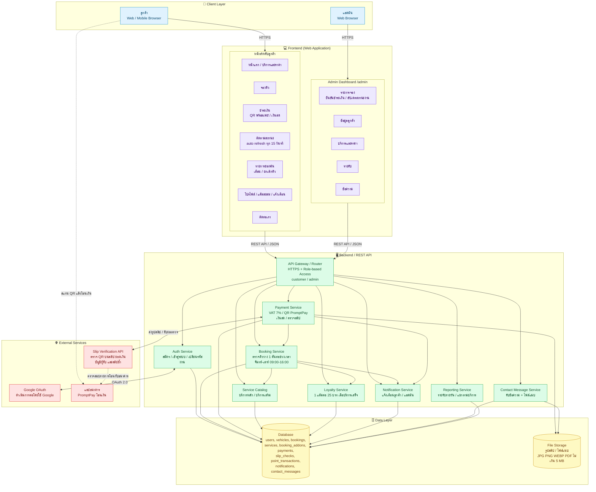
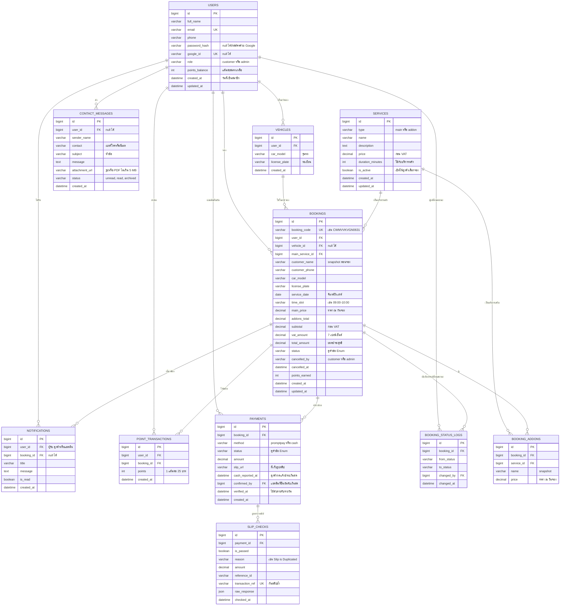
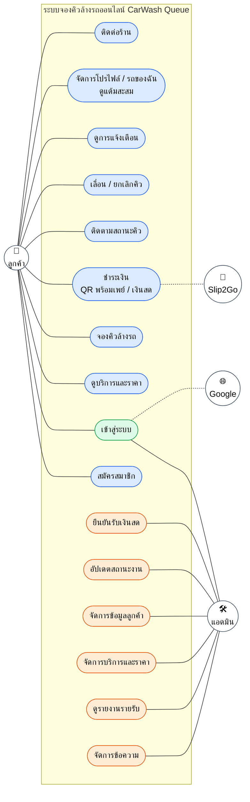
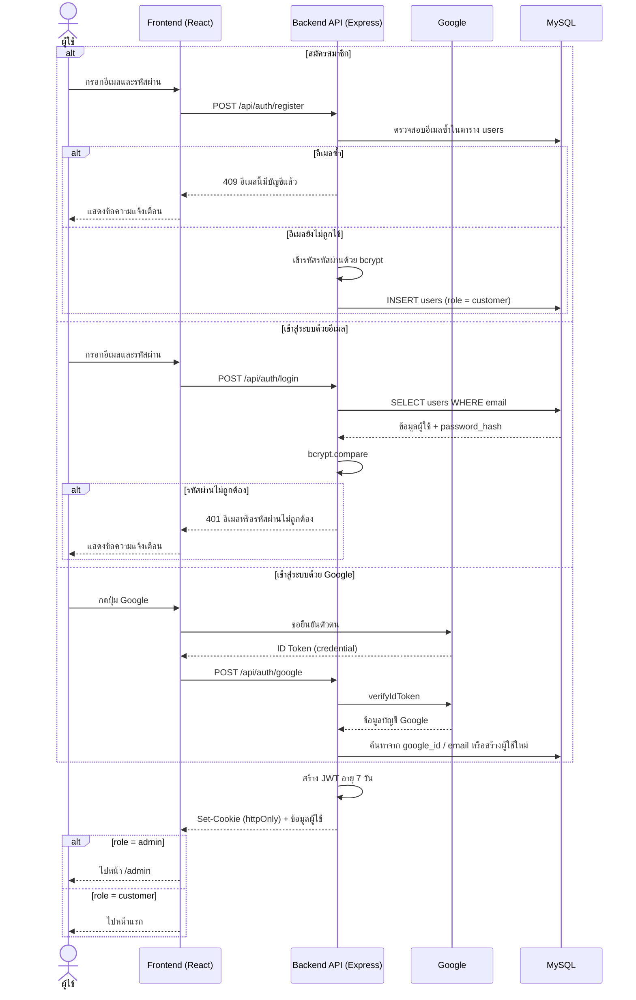
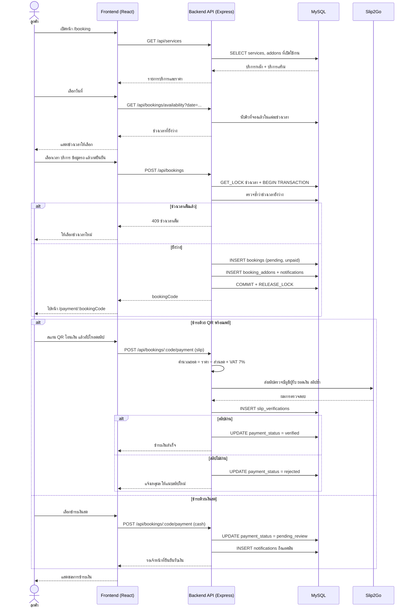
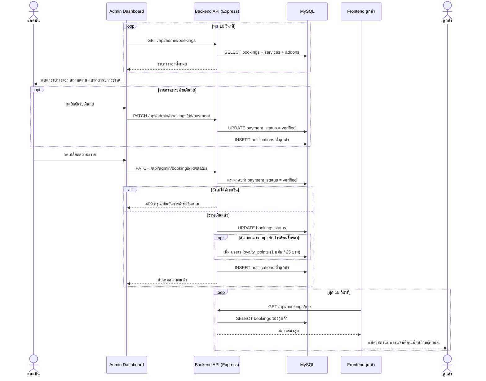

# CarWash Queue - Group22

## สมาชิกในกลุ่ม (Project Members)

| ลำดับ | รหัสนิสิต | ชื่อ - นามสกุล | บทบาทหน้าที่ความรับผิดชอบ |
|:---:|:---:|:---|:---|
| 1 | 6621601018 | นายปฏิภาณ อาจเพล | **Backend**|
| 2 | 6621601166 | นายภูริพัฒน์ จันทร์อักษร | **UX/UI**|
| 3 | 6621601271 | นายอนาวิล ย้อยแย้ม | **Fontend,Tester**|

**ลิงก์เว็บไซต์ที่ Deploy ใช้งานจริง:** `https://carwash.carcareku.tech/`

---
### 1) ภาพรวมของระบบ (System Overview)

### 1.1 ที่มาและปัญหาที่ระบบต้องการแก้ไข

ร้านล้างรถแบบเดิมมักรับลูกค้าแบบ walk-in หรือจองผ่านโทรศัพท์/แชต ซึ่งทำให้เกิดปัญหาดังนี้

1. ลูกค้าต้องรอคิวนาน เพราะไม่รู้ล่วงหน้าว่าช่วงไหนว่าง บางช่วงลูกค้ามากันจนแออัด แต่บางช่วงร้านว่าง
2. การจัดคิวทำด้วยมือและผิดพลาดง่าย การจดคิวลงสมุดหรือรับจองทางโทรศัพท์อาจทำให้จองซ้ำช่วงเวลาเดียวกัน หรือข้อมูลรถและบริการตกหล่น
3. ลูกค้าไม่รู้สถานะรถ ต้องโทรถามหรือมารอที่ร้านเองว่ารถล้างเสร็จหรือยัง
4. ตรวจสอบการชำระเงินยาก พนักงานต้องดูสลิปโอนเงินทีละใบ เสี่ยงต่อสลิปปลอม สลิปซ้ำ หรือยอดเงินไม่ตรง
5. ไม่มีข้อมูลลูกค้าและรายรับเป็นระบบ ร้านจึงวิเคราะห์ยอดขาย ดูประวัติลูกค้า หรือทำโปรแกรมสะสมแต้มได้ยาก
6. การปรับบริการและราคาไม่สะดวก ทุกครั้งที่เปลี่ยนแพ็กเกจหรือราคา ต้องแจ้งลูกค้าเองทีละช่องทาง

ระบบ CarWash Queue จึงถูกพัฒนาขึ้นเพื่อย้ายขั้นตอนตั้งแต่การจองคิว การชำระเงิน การติดตามสถานะ ไปจนถึงการบริหารจัดการร้าน มาไว้บนเว็บไซต์เดียว

### 1.2 วัตถุประสงค์ของระบบ
1. ให้ลูกค้าจองคิวล้างรถออนไลน์ได้ล่วงหน้า โดยเลือกวัน ช่วงเวลา บริการหลัก และบริการเสริมเองได้ พร้อมเห็นจำนวนคิวว่างแบบเรียลไทม์
2. ป้องกันการจองซ้อนและจัดคิวให้เป็นระบบ ร้านเปิดวันจันทร์–เสาร์ เวลา 09:00–16:00 น. แบ่งเป็น 6 ช่วงเวลา ช่วงละ 1 คัน (เว้นช่วงพักเที่ยง) และระบบไม่รับจองวันอาทิตย์
3. รองรับการชำระเงินทั้งพร้อมเพย์/QR Code ที่ระบบตรวจสลิปให้อัตโนมัติ (ตรวจ QR ยอดเงิน บัญชีผู้รับ และสลิปซ้ำ) และเงินสดที่ร้านซึ่งแอดมินเป็นผู้ยืนยัน โดยระบบคำนวณ VAT 7% ให้อัตโนมัติ
4. ให้ลูกค้าติดตามสถานะรถได้เองผ่านแถบความคืบหน้า 4 ขั้น ซึ่งอัปเดตอัตโนมัติทุก 15 วินาที และมีการแจ้งเตือนเมื่อสถานะเปลี่ยน
5. เพิ่มความยืดหยุ่นให้ลูกค้า โดยเลื่อนวัน/เวลา หรือยกเลิกการจองได้เอง
6. สร้างความภักดีของลูกค้าด้วยระบบแต้มสะสม (ได้ 1 แต้มทุกยอดใช้จ่าย 25 บาท เมื่อบริการเสร็จสิ้น)
7. ช่วยให้ร้านบริหารงานได้ง่ายขึ้นผ่านหน้าแอดมินสำหรับจัดการคิว ข้อมูลลูกค้า บริการและราคา รายงานรายรับ และข้อความจากลูกค้า
### 1.3 กลุ่มผู้ใช้และบทบาทของแต่ละกลุ่ม

| กลุ่มผู้ใช้ | บทบาทและสิทธิ์การใช้งาน |
|---|---|
| **ผู้เยี่ยมชมทั่วไป (Guest)** | ดูหน้าแรก ขั้นตอนการจอง และบริการพร้อมราคาได้ แต่ต้องสมัครสมาชิกหรือเข้าสู่ระบบก่อนจึงจะจองคิว ดูประวัติ หรือติดตามสถานะได้ |
| **ลูกค้า (Customer)** | สมัครสมาชิกหรือเข้าสู่ระบบด้วยอีเมลหรือบัญชี Google, จองคิว, ชำระเงินด้วย QR พร้อมเพย์ (แนบสลิป) หรือเงินสด, ติดตามสถานะรถ, ดูประวัติการจอง, เลื่อนหรือยกเลิกการจอง, ดูโปรไฟล์และแต้มสะสม, รับการแจ้งเตือน และส่งข้อความถึงร้าน |
| **ผู้ดูแลระบบ (Admin)** | เข้าสู่ระบบผ่านหน้าเดียวกับลูกค้าแล้วระบบจะพาไปหน้า Admin Dashboard (`/admin`) เพื่อดู ค้นหา และกรองรายการจองทั้งหมด, ยืนยันการชำระเงิน (ตรวจผลสลิป/ยืนยันรับเงินสด), อัปเดตสถานะงาน (รับรถเข้าคิว → เริ่มให้บริการ → พร้อมรับรถ), ยกเลิกการจอง, ดูข้อมูลและประวัติลูกค้า, เพิ่ม/แก้ไข/ปิดบริการ, ดูรายงานรายรับ และอ่าน/จัดการข้อความจากลูกค้า |

### 1.4 รายการฟังก์ชันหลักของระบบ

#### ฝั่งลูกค้า

| ลำดับ | ฟังก์ชัน | รายละเอียด |
|:---:|---|---|
| F01 | สมัครสมาชิก / เข้าสู่ระบบ | ใช้อีเมลและรหัสผ่าน หรือเข้าด้วยบัญชี Google |
| F02 | ดูบริการและราคา | แพ็กเกจหลัก 3 แบบ (Standard Wash, Premium Wash, Full Detailing) และบริการเสริม เช่น เคลือบแก้วเซรามิก ขัดโคมไฟหน้า อบโอโซน ล้างห้องเครื่อง |
| F03 | จองคิว | เลือกวันที่ ช่วงเวลา (แสดงคิวว่าง) บริการหลัก บริการเสริม กรอกข้อมูลลูกค้าและรถ พร้อมกล่องสรุปรายการจอง |
| F04 | ชำระเงิน | คำนวณยอดรวม VAT 7% แล้วชำระผ่าน QR พร้อมเพย์ (ตรวจสลิปอัตโนมัติ) หรือเงินสดที่ร้าน และกลับมาชำระต่อภายหลังได้ |
| F05 | ติดตามสถานะ | แถบความคืบหน้า 4 ขั้น: รอยืนยันการจอง → รับรถเข้าคิวแล้ว → กำลังให้บริการ → พร้อมรับรถแล้ว |
| F06 | รายการของฉัน | ดูประวัติการจอง ค้นหา/กรองตามสถานะหรือวันที่ ดูรายละเอียด เลื่อนวันและเวลา หรือยกเลิกการจอง |
| F07 | โปรไฟล์และแต้มสะสม | ดูข้อมูลส่วนตัวและแต้มสะสมที่ได้จากการใช้บริการ |
| F08 | การแจ้งเตือน | แจ้งเตือนผ่านไอคอนกระดิ่งเมื่อสถานะการจองหรือการชำระเงินเปลี่ยน |
| F09 | ติดต่อเรา | ส่งข้อความถึงร้านตามหัวข้อ (สอบถามบริการ/การจอง, แจ้งปัญหา, ข้อเสนอแนะ) แนบรูปหรือ PDF ได้ไม่เกิน 5 MB |

#### ฝั่งผู้ดูแลระบบ

| ลำดับ | ฟังก์ชัน | รายละเอียด |
|:---:|---|---|
| A01 | จัดการรายการจอง | ตารางการจองทั้งหมด ค้นหาด้วยรหัสจอง ชื่อ หรือทะเบียนรถ กรองตามสถานะการจอง สถานะการชำระเงิน และวันที่ |
| A02 | ยืนยันการชำระเงิน | ดูสลิปและประวัติผลตรวจ (ผ่าน/ไม่ผ่าน เหตุผล ยอดเงิน Reference ID) และกดยืนยันรับเงินสด |
| A03 | อัปเดตสถานะงาน | รับรถเข้าคิว → เริ่มให้บริการ → พร้อมรับรถ หรือยกเลิกการจองก่อนจบงาน |
| A04 | ข้อมูลลูกค้า | รายชื่อ ข้อมูลติดต่อ แต้มสะสม จำนวนการจอง และประวัติการใช้บริการรายบุคคล |
| A05 | จัดการบริการและราคา | เพิ่ม แก้ไข และเปิด/ปิดบริการหลักและบริการเสริม (ราคาใหม่มีผลกับการจองใหม่เท่านั้น) |
| A06 | รายงานรายรับ | สรุปยอดรับชำระรวม VAT, ยอดก่อน VAT, รายรับรายวัน, รายรับแยกตามบริการ และรายการรับชำระรายตัว ตามช่วงวันที่ที่เลือก |
| A07 | จัดการข้อความ | อ่าน ค้นหา และกรองข้อความตามสถานะ (ยังไม่อ่าน/อ่านแล้ว/เก็บถาวร) และลบข้อความ |
| A08 | การแจ้งเตือนแอดมิน | แจ้งเมื่อมีการจองใหม่ ยืนยันการชำระเงินแล้ว สลิปไม่ผ่านการตรวจ หรือสถานะงานเปลี่ยน |

---
### 2) โครงสร้างของระบบ (System Architecture)

### 2.1 แผนภาพสถาปัตยกรรมระบบ

แสดงส่วนประกอบหลักและการเชื่อมต่อของระบบ ตั้งแต่ **Client → Frontend → Backend / API → Database** รวมถึงบริการภายนอก

---

### 2.2 โครงสร้างโฟลเดอร์ของโปรเจกต์

```mermaid
flowchart LR
    ROOT["📦 car-wash-project<br/>ระบบจองคิวล้างรถออนไลน์"]:::root

    %% ================= ROOT FILES =================
    ROOT --> R1[".gitignore<br/>ไฟล์ที่ไม่นำขึ้น Git"]:::file
    ROOT --> R2[".keep<br/>ไฟล์เปล่าเพื่อเก็บโฟลเดอร์"]:::file
    ROOT --> R3["docker-compose.yml<br/>รันทุก service ตอนพัฒนา"]:::file
    ROOT --> R4["docker-compose.production.yml<br/>ตั้งค่า Docker สำหรับ production"]:::file
    ROOT --> R5["README.md<br/>เอกสารอธิบายโปรเจกต์"]:::file

    %% ================= .github =================
    ROOT --> GH["📁 .github"]:::folder
    GH --> GHW["📁 workflows<br/>GitHub Actions"]:::folder
    GHW --> GHW1["deploy.yml<br/>CI/CD deploy อัตโนมัติ"]:::file

    %% ================= client =================
    ROOT --> CL["📁 client<br/>Frontend: React + Vite + Tailwind"]:::folder
    CL --> CL1[".dockerignore<br/>ไฟล์ที่ไม่ใส่ใน Docker image"]:::file
    CL --> CL2[".env.example<br/>ตัวอย่างตัวแปรสภาพแวดล้อม"]:::file
    CL --> CL3["Dockerfile<br/>build image ฝั่งหน้าเว็บ"]:::file
    CL --> CL4["index.html<br/>หน้า HTML หลักของแอป"]:::file
    CL --> CL5["nginx.conf<br/>เสิร์ฟไฟล์เว็บใน container"]:::file
    CL --> CL6["package.json<br/>รายการ dependencies และ scripts"]:::file
    CL --> CL7["package-lock.json<br/>ล็อกเวอร์ชัน dependencies"]:::file
    CL --> CL8["postcss.config.js<br/>ตั้งค่า PostCSS"]:::file
    CL --> CL9["tailwind.config.js<br/>ตั้งค่า Tailwind CSS"]:::file
    CL --> CL10["vercel.json<br/>ตั้งค่า deploy บน Vercel"]:::file
    CL --> CL11["vite.config.js<br/>ตั้งค่า Vite build tool"]:::file

    CL --> PUB["📁 public"]:::folder
    PUB --> IMG["📁 images<br/>รูปภาพที่ใช้ในเว็บ"]:::folder
    IMG --> IMG1["car-wash-1 ถึง 4.png<br/>รูปประกอบหน้าเว็บ"]:::file
    IMG --> IMG2["cash-payment.png<br/>ไอคอนชำระเงินสด"]:::file
    IMG --> IMG3["slip2go-logo.png<br/>โลโก้ระบบตรวจสลิป"]:::file

    CL --> SRC["📁 src<br/>ซอร์สโค้ดหน้าเว็บ"]:::folder
    SRC --> S1["main.jsx<br/>จุดเริ่มต้นแอป React"]:::file
    SRC --> S2["App.jsx<br/>กำหนด routes ของแต่ละหน้า"]:::file
    SRC --> S3["api.js<br/>ฟังก์ชันเรียก Backend API"]:::file
    SRC --> S4["auth.jsx<br/>จัดการสถานะล็อกอิน"]:::file
    SRC --> S5["index.css<br/>สไตล์หลักและ Tailwind"]:::file

    SRC --> COMP["📁 components<br/>คอมโพเนนต์ที่ใช้ซ้ำ"]:::folder
    COMP --> CO1["GoogleSignInButton.jsx<br/>ปุ่มเข้าสู่ระบบด้วย Google"]:::file
    COMP --> CO2["Icons.jsx<br/>รวมไอคอน SVG"]:::file
    COMP --> CO3["Layout.jsx<br/>โครงหน้า header / footer"]:::file
    COMP --> CO4["RouteGuards.jsx<br/>ป้องกันหน้าที่ต้องล็อกอิน / admin"]:::file

    SRC --> PG["📁 pages<br/>หน้าต่าง ๆ ของเว็บ"]:::folder
    PG --> PG1["HomePage.jsx<br/>หน้าแรก"]:::file
    PG --> PG2["ServicesPage.jsx<br/>รายการบริการและราคา"]:::file
    PG --> PG3["BookingPage.jsx<br/>จองคิวล้างรถ"]:::file
    PG --> PG4["PaymentPage.jsx<br/>ชำระเงิน / แนบสลิป"]:::file
    PG --> PG5["StatusPage.jsx<br/>สถานะการจอง"]:::file
    PG --> PG6["TrackingPage.jsx<br/>ติดตามคิว"]:::file
    PG --> PG7["NotificationsPage.jsx<br/>การแจ้งเตือน"]:::file
    PG --> PG8["ProfilePage.jsx<br/>โปรไฟล์และแต้มสะสม"]:::file
    PG --> PG9["ContactPage.jsx<br/>ติดต่อร้าน / แนบไฟล์"]:::file
    PG --> PG10["AuthPage.jsx<br/>สมัครสมาชิก / เข้าสู่ระบบ"]:::file
    PG --> PG11["AdminPage.jsx<br/>แผงควบคุมผู้ดูแลระบบ"]:::file

    SRC --> CUT["📁 utils<br/>ฟังก์ชันช่วยเหลือ"]:::folder
    CUT --> CUT1["date.js<br/>จัดรูปแบบวันที่และเวลา"]:::file

    %% ================= database =================
    ROOT --> DB["📁 database<br/>โครงสร้างฐานข้อมูล"]:::folder
    DB --> DB1["schema.sql<br/>สร้างตารางทั้งหมด"]:::file
    DB --> DB2["seed.sql<br/>ข้อมูลตั้งต้น"]:::file
    DB --> MIG["📁 migrations<br/>อัปเดตฐานข้อมูลตามลำดับ"]:::folder
    MIG --> M2["002_booking_slot_index.sql<br/>index ช่วงเวลาการจอง"]:::file
    MIG --> M3["003_google_auth.sql<br/>รองรับล็อกอิน Google"]:::file
    MIG --> M4["004_loyalty_points.sql<br/>ระบบแต้มสะสม"]:::file
    MIG --> M5["005_profile_notifications.sql<br/>โปรไฟล์และการแจ้งเตือน"]:::file
    MIG --> M6["006_booking_in_service_status.sql<br/>สถานะกำลังให้บริการ"]:::file
    MIG --> M7["007_payment_summary.sql<br/>สรุปข้อมูลการชำระเงิน"]:::file
    MIG --> M8["008_slip_verification_history.sql<br/>ประวัติการตรวจสลิป"]:::file
    MIG --> M9["009_payment_timestamp.sql<br/>เวลาที่ชำระเงิน"]:::file
    MIG --> M10["010_cash_payment_method.sql<br/>เพิ่มการชำระด้วยเงินสด"]:::file
    MIG --> M11["011_contact_attachment_original_name.sql<br/>เก็บชื่อไฟล์แนบต้นฉบับ"]:::file

    %% ================= deploy =================
    ROOT --> DP["📁 deploy<br/>ไฟล์สำหรับเซิร์ฟเวอร์จริง"]:::folder
    DP --> DP1["nginx-carwash.conf.example<br/>ตัวอย่าง Nginx reverse proxy"]:::file

    %% ================= server =================
    ROOT --> SV["📁 server<br/>Backend: Node.js + Express"]:::folder
    SV --> SV1[".dockerignore<br/>ไฟล์ที่ไม่ใส่ใน Docker image"]:::file
    SV --> SV2[".env.example<br/>ตัวอย่างตัวแปร เช่น DB, secret"]:::file
    SV --> SV3["Dockerfile<br/>build image ฝั่ง API"]:::file
    SV --> SV4["package.json<br/>รายการ dependencies และ scripts"]:::file
    SV --> SV5["package-lock.json<br/>ล็อกเวอร์ชัน dependencies"]:::file

    SV --> SSRC["📁 src<br/>ซอร์สโค้ด API"]:::folder
    SSRC --> SS1["server.js<br/>จุดเริ่มต้น Express server"]:::file
    SSRC --> SS2["db.js<br/>เชื่อมต่อฐานข้อมูล"]:::file

    SSRC --> MW["📁 middleware<br/>ทำงานก่อนเข้า route"]:::folder
    MW --> MW1["auth.js<br/>ตรวจ token และสิทธิ์ผู้ใช้"]:::file
    MW --> MW2["upload.js<br/>อัปโหลดไฟล์ทั่วไป"]:::file
    MW --> MW3["privateUpload.js<br/>อัปโหลดไฟล์ส่วนตัว เช่น สลิป"]:::file

    SSRC --> RT["📁 routes<br/>API endpoints"]:::folder
    RT --> RT1["auth.js<br/>สมัคร / ล็อกอิน / Google"]:::file
    RT --> RT2["services.js<br/>ข้อมูลบริการ"]:::file
    RT --> RT3["bookings.js<br/>การจองและการชำระเงิน"]:::file
    RT --> RT4["profile.js<br/>ข้อมูลโปรไฟล์ผู้ใช้"]:::file
    RT --> RT5["notifications.js<br/>การแจ้งเตือน"]:::file
    RT --> RT6["contacts.js<br/>ข้อความติดต่อ"]:::file
    RT --> RT7["admin.js<br/>API สำหรับผู้ดูแลระบบ"]:::file

    SSRC --> SUT["📁 utils<br/>ฟังก์ชันช่วยเหลือ"]:::folder
    SUT --> SUT1["filename.js<br/>ตั้งชื่อไฟล์อัปโหลดให้ปลอดภัย"]:::file

    SV --> UP["📁 uploads<br/>เก็บไฟล์ที่ผู้ใช้อัปโหลด"]:::folder
    UP --> UP1[".gitkeep<br/>เก็บโฟลเดอร์ว่างไว้ใน Git"]:::file

    %% ================= STYLES =================
    classDef root fill:#2b6cb0,stroke:#1a4971,color:#ffffff,font-weight:bold
    classDef folder fill:#fff4d6,stroke:#e0a800,color:#333333,font-weight:bold
    classDef file fill:#eef4ff,stroke:#6c8ebf,color:#333333
```

####  Root

| ไฟล์ / โฟลเดอร์ | คำอธิบาย |
|---|---|
| `.gitignore` | ระบุไฟล์ที่ไม่นำขึ้น Git เช่น `node_modules`, `.env` |
| `.keep` | ไฟล์เปล่าสำหรับเก็บโฟลเดอร์ไว้ใน Git |
| `docker-compose.yml` | รัน client, server และฐานข้อมูลพร้อมกันตอนพัฒนา |
| `docker-compose.production.yml` | ตั้งค่า Docker สำหรับขึ้นระบบจริง (production) |
| `README.md` | เอกสารอธิบายโปรเจกต์ |
| `.github/workflows/deploy.yml` | GitHub Actions สำหรับ deploy อัตโนมัติเมื่อ push โค้ด |
| `deploy/nginx-carwash.conf.example` | ตัวอย่างค่าตั้ง Nginx reverse proxy บนเซิร์ฟเวอร์จริง |

####  client — Frontend (React + Vite + Tailwind)

| ไฟล์ / โฟลเดอร์ | คำอธิบาย |
|---|---|
| `client/.dockerignore` | ไฟล์ที่ไม่ใส่ใน Docker image |
| `client/.env.example` | ตัวอย่างตัวแปรสภาพแวดล้อม เช่น URL ของ API |
| `client/Dockerfile` | build image ฝั่งหน้าเว็บ |
| `client/nginx.conf` | ตั้งค่า Nginx สำหรับเสิร์ฟหน้าเว็บใน container |
| `client/index.html` | หน้า HTML หลักของแอป |
| `client/package.json` | รายการ dependencies และ scripts |
| `client/package-lock.json` | ล็อกเวอร์ชัน dependencies |
| `client/vite.config.js` | ตั้งค่า Vite (build tool) |
| `client/tailwind.config.js` | ตั้งค่า Tailwind CSS |
| `client/postcss.config.js` | ตั้งค่า PostCSS |
| `client/vercel.json` | ตั้งค่าการ deploy บน Vercel |
| `client/public/images/car-wash-1~4.png` | รูปภาพประกอบหน้าเว็บ |
| `client/public/images/cash-payment.png` | ไอคอนชำระเงินสด |
| `client/public/images/slip2go-logo.png` | โลโก้ระบบตรวจสลิป Slip2Go |

####  client/src — ซอร์สโค้ดหน้าเว็บ

| ไฟล์ / โฟลเดอร์ | คำอธิบาย |
|---|---|
| `client/src/main.jsx` | จุดเริ่มต้นของแอป React |
| `client/src/App.jsx` | กำหนดเส้นทาง (routes) ของแต่ละหน้า |
| `client/src/api.js` | รวมฟังก์ชันเรียก Backend API |
| `client/src/auth.jsx` | จัดการสถานะการล็อกอินของผู้ใช้ |
| `client/src/index.css` | สไตล์หลักและ Tailwind |
| `client/src/utils/date.js` | ฟังก์ชันจัดรูปแบบวันที่และเวลา |
| `client/src/components/GoogleSignInButton.jsx` | ปุ่มเข้าสู่ระบบด้วย Google |
| `client/src/components/Icons.jsx` | รวมไอคอน SVG ที่ใช้ในเว็บ |
| `client/src/components/Layout.jsx` | โครงหน้าเว็บ (header / footer / เมนู) |
| `client/src/components/RouteGuards.jsx` | ป้องกันหน้าที่ต้องล็อกอินหรือเฉพาะ admin |

####  client/src/pages — หน้าต่าง ๆ ของเว็บ

| ไฟล์ | คำอธิบาย |
|---|---|
| `HomePage.jsx` | หน้าแรกของเว็บไซต์ |
| `ServicesPage.jsx` | แสดงรายการบริการและราคา |
| `BookingPage.jsx` | เลือกบริการ วัน และเวลาเพื่อจองคิว |
| `PaymentPage.jsx` | ชำระเงิน แนบสลิป หรือเลือกเงินสด |
| `StatusPage.jsx` | แสดงสถานะการจอง |
| `TrackingPage.jsx` | ติดตามคิวล้างรถ |
| `NotificationsPage.jsx` | รายการแจ้งเตือนของผู้ใช้ |
| `ProfilePage.jsx` | ข้อมูลโปรไฟล์และแต้มสะสม |
| `ContactPage.jsx` | ส่งข้อความติดต่อร้านพร้อมแนบไฟล์ |
| `AuthPage.jsx` | สมัครสมาชิก / เข้าสู่ระบบ |
| `AdminPage.jsx` | แผงควบคุมสำหรับผู้ดูแลระบบ |

####  database — ฐานข้อมูล

| ไฟล์ | คำอธิบาย |
|---|---|
| `database/schema.sql` | สร้างตารางทั้งหมดของระบบ |
| `database/seed.sql` | ใส่ข้อมูลตั้งต้น เช่น รายการบริการ |
| `migrations/002_booking_slot_index.sql` | เพิ่ม index ช่วงเวลาการจอง |
| `migrations/003_google_auth.sql` | รองรับการล็อกอินด้วย Google |
| `migrations/004_loyalty_points.sql` | เพิ่มระบบแต้มสะสม |
| `migrations/005_profile_notifications.sql` | เพิ่มข้อมูลโปรไฟล์และการแจ้งเตือน |
| `migrations/006_booking_in_service_status.sql` | เพิ่มสถานะ "กำลังให้บริการ" |
| `migrations/007_payment_summary.sql` | เพิ่มข้อมูลสรุปการชำระเงิน |
| `migrations/008_slip_verification_history.sql` | เก็บประวัติการตรวจสลิป |
| `migrations/009_payment_timestamp.sql` | เก็บเวลาที่ชำระเงิน |
| `migrations/010_cash_payment_method.sql` | เพิ่มวิธีชำระด้วยเงินสด |
| `migrations/011_contact_attachment_original_name.sql` | เก็บชื่อไฟล์แนบต้นฉบับของข้อความติดต่อ |

####  server — Backend (Node.js + Express)

| ไฟล์ / โฟลเดอร์ | คำอธิบาย |
|---|---|
| `server/.dockerignore` | ไฟล์ที่ไม่ใส่ใน Docker image |
| `server/.env.example` | ตัวอย่างตัวแปร เช่น ค่าเชื่อมต่อฐานข้อมูล, secret key |
| `server/Dockerfile` | build image ฝั่ง API |
| `server/package.json` | รายการ dependencies และ scripts |
| `server/package-lock.json` | ล็อกเวอร์ชัน dependencies |
| `server/uploads/` | โฟลเดอร์เก็บไฟล์ที่ผู้ใช้อัปโหลด (`.gitkeep` ใช้เก็บโฟลเดอร์ว่างไว้ใน Git) |
| `server/src/server.js` | จุดเริ่มต้นของ Express API server |
| `server/src/db.js` | เชื่อมต่อฐานข้อมูล |
| `server/src/middleware/auth.js` | ตรวจ token และสิทธิ์ผู้ใช้ก่อนเข้าถึง API |
| `server/src/middleware/upload.js` | จัดการอัปโหลดไฟล์ทั่วไป |
| `server/src/middleware/privateUpload.js` | จัดการไฟล์ส่วนตัว เช่น สลิปโอนเงิน |
| `server/src/utils/filename.js` | ตั้งชื่อไฟล์อัปโหลดให้ปลอดภัยและไม่ซ้ำกัน |

####  server/src/routes — API Endpoints

| ไฟล์ | คำอธิบาย |
|---|---|
| `auth.js` | สมัครสมาชิก / เข้าสู่ระบบ / ล็อกอินด้วย Google |
| `services.js` | ข้อมูลบริการล้างรถ |
| `bookings.js` | สร้างการจอง ดูสถานะ และชำระเงิน |
| `profile.js` | ดูและแก้ไขข้อมูลโปรไฟล์ |
| `notifications.js` | การแจ้งเตือนของผู้ใช้ |
| `contacts.js` | รับข้อความติดต่อจากลูกค้า |
| `admin.js` | API สำหรับผู้ดูแลระบบ |

---

### 2.3 โครงสร้างฐานข้อมูล (ER Diagram)

---

### คำอธิบายแต่ละ Table

| # | Table | หน้าที่ |
|---|---|---|
| 1 | `users` | บัญชีผู้ใช้ทั้งลูกค้าและแอดมิน |
| 2 | `vehicles` | รถของลูกค้า |
| 3 | `services` | บริการหลักและบริการเสริมพร้อมราคา |
| 4 | `bookings` | การจองคิว (ตารางหลัก) |
| 5 | `booking_addons` | บริการเสริมในแต่ละการจอง |
| 6 | `payments` | การชำระเงิน |
| 7 | `slip_checks` | ประวัติผลตรวจสลิป |
| 8 | `point_transactions` | ประวัติแต้มสะสม |
| 9 | `notifications` | การแจ้งเตือน |
| 10 | `contact_messages` | ข้อความจากหน้า "ติดต่อเรา" |
| 11 | `booking_status_logs` | ประวัติการเปลี่ยนสถานะการจอง (เสริม) |

#### `users` — ผู้ใช้งาน

เก็บบัญชีทั้งลูกค้าและแอดมินไว้ใน table เดียว แยกด้วย `role`

| Column | คำอธิบาย |
|---|---|
| `id` | รหัสผู้ใช้ (PK) |
| `full_name`, `email`, `phone` | ข้อมูลส่วนตัว แสดงในหน้าโปรไฟล์และหน้าข้อมูลลูกค้าของแอดมิน |
| `password_hash` | รหัสผ่านที่เข้ารหัสแล้ว (ว่างได้ถ้าเข้าสู่ระบบด้วย Google อย่างเดียว) |
| `google_id` | รหัสบัญชี Google สำหรับ "ดำเนินการต่อโดยใช้ Google" |
| `role` | `customer` หรือ `admin` ใช้กำหนดสิทธิ์เข้า `/admin` |
| `points_balance` | แต้มสะสมคงเหลือ (เก็บซ้ำเพื่อให้เรียกดูได้เร็ว ตรวจสอบย้อนหลังได้จาก `point_transactions`) |
| `created_at` | วันที่เป็นสมาชิก |

#### `vehicles` — ประวัติรถ

รถที่ลูกค้าเคยจองหรือบันทึกไว้ (ปุ่ม **+ เพิ่มรถ** ในหน้าโปรไฟล์) ลูกค้า 1 คนมีได้หลายคัน

| Column | คำอธิบาย |
|---|---|
| `user_id` | เจ้าของรถ (FK → `users`) |
| `car_model` | รุ่นรถ เช่น adv150, wave125 |
| `license_plate` | ทะเบียนรถ ใช้ค้นหาในหน้าแอดมิน |

#### `services` — บริการและราคา

เก็บทั้งบริการหลัก (Standard / Premium / Full Detailing) และบริการเสริม (เคลือบแก้ว, ขัดโคมไฟ ฯลฯ) แยกด้วย `type`

| Column | คำอธิบาย |
|---|---|
| `type` | `main` = บริการหลัก, `addon` = บริการเสริม |
| `price` | ราคาก่อน VAT 7% |
| `duration_minutes` | ระยะเวลาให้บริการ (ใช้กับบริการหลัก) |
| `is_active` | เปิดให้ลูกค้าเลือกจองหรือไม่ ปุ่ม "ปิดบริการ" จะตั้งค่าเป็น `false` แทนการลบ เพื่อให้ประวัติเดิมยังอ้างอิงได้ |

#### `bookings` — การจอง (ตารางหลัก)

1 แถวต่อ 1 การจอง

| Column | คำอธิบาย |
|---|---|
| `booking_code` | รหัสจองที่แสดงให้ลูกค้า ใช้ค้นหาและติดตามสถานะ |
| `user_id`, `vehicle_id`, `main_service_id` | อ้างอิงลูกค้า รถ และบริการหลัก |
| `customer_name`, `customer_phone`, `car_model`, `license_plate` | สำเนาข้อมูลตอนจอง (snapshot) เพื่อไม่ให้เปลี่ยนตามโปรไฟล์ภายหลัง |
| `service_date`, `time_slot` | วันและช่วงเวลา (จันทร์–เสาร์ 09:00–16:00 เว้นพักเที่ยง) |
| `main_price`, `addons_total`, `subtotal`, `vat_amount`, `total_amount` | ราคา ณ วันจอง การปรับราคาภายหลังจึงไม่กระทบการจองเดิม |
| `status` | สถานะการจอง (ดู [ค่า Enum](#25-ค่า-enum)) |
| `cancelled_by`, `cancelled_at` | ผู้ยกเลิกและเวลาที่ยกเลิก |
| `points_earned` | แต้มที่ได้รับเมื่อสถานะเป็น "พร้อมรับรถแล้ว" |

> **กฎสำคัญ:** 1 ช่วงเวลารับได้ 1 คัน ให้ตั้ง unique index บน `(service_date, time_slot)` เฉพาะแถวที่ `status <> 'cancelled'` (partial unique index) เพื่อกันการจองซ้อนกัน

#### `booking_addons` — บริการเสริมในแต่ละการจอง

ตารางเชื่อมแบบ many-to-many ระหว่าง `bookings` กับ `services` (เฉพาะ `type = addon`) และเก็บ `name` กับ `price` ณ วันจองไว้ด้วย

#### `payments` — การชำระเงิน

แยกออกจาก `bookings` เพื่อรองรับกรณีสลิปไม่ผ่านแล้วลูกค้าส่งใหม่ หรือเปลี่ยนช่องทางชำระเงิน

| Column | คำอธิบาย |
|---|---|
| `method` | `promptpay` (QR + สลิป) หรือ `cash` (จ่ายที่ร้าน) |
| `status` | สถานะการชำระเงิน (ดู [ค่า Enum](#25-ค่า-enum)) |
| `slip_url` | ตำแหน่งไฟล์สลิป (JPG, PNG, WEBP) |
| `cash_reported_at` | เวลาที่ลูกค้ากด "แจ้งชำระเงินสด" |
| `confirmed_by` | แอดมินที่กดยืนยันรับเงินสด |
| `verified_at` | เวลาที่ยืนยันการชำระเงินจริง — **หน้ารายรับใช้ฟิลด์นี้นับยอดรายวัน** ไม่ใช่วันที่นัดล้างรถ |

#### `slip_checks` — ประวัติผลตรวจสลิป

เก็บผลตรวจจากบริการตรวจสลิปทุกครั้ง (ปุ่ม "ประวัติผลตรวจ" ของแอดมิน)

| Column | คำอธิบาย |
|---|---|
| `is_passed` | ผ่านหรือไม่ผ่าน |
| `reason` | เหตุผล เช่น Slip is Duplicated, ยอดไม่ตรง |
| `reference_id`, `transaction_ref` | รหัสอ้างอิงจากผู้ให้บริการและธนาคาร ใช้ตรวจสลิปซ้ำ (`transaction_ref` ควรเป็น unique เมื่อตรวจผ่านแล้ว) |
| `raw_response` | ผลตอบกลับดิบจาก API เก็บไว้ตรวจสอบย้อนหลัง |

#### `point_transactions` — ประวัติแต้มสะสม

บันทึกแต้มทุกครั้งที่ได้รับ (1 แต้มต่อทุก 25 บาท เมื่อบริการเสร็จสิ้น) ใช้แสดงในหน้า Customer Record ของแอดมิน และใช้ตรวจสอบความถูกต้องของ `users.points_balance`

#### `notifications` — การแจ้งเตือน

ใช้กับไอคอนกระดิ่งของทั้งลูกค้าและแอดมิน

| Column | คำอธิบาย |
|---|---|
| `user_id` | ผู้รับการแจ้งเตือน |
| `booking_id` | การจองที่เกี่ยวข้อง (ว่างได้) |
| `is_read` | ใช้แสดงตัวเลขสีแดงของรายการที่ยังไม่อ่าน |

ตัวอย่างเหตุการณ์ที่แจ้งเตือน:

- **ลูกค้า:** ได้รับคำขอจอง, รับรถเข้าคิวแล้ว, กำลังให้บริการ, พร้อมรับรถแล้ว
- **แอดมิน:** ยืนยันชำระเงินแล้ว, สลิปไม่ผ่าน

#### `contact_messages` — ข้อความจากหน้า "ติดต่อเรา"

| Column | คำอธิบาย |
|---|---|
| `subject` | สอบถามบริการ / สอบถามการจอง / แจ้งปัญหา / ข้อเสนอแนะ |
| `attachment_url` | ไฟล์แนบ (รูปภาพหรือ PDF ไม่เกิน 5 MB) |
| `status` | `unread` / `read` / `archived` (ยังไม่อ่าน / อ่านแล้ว / เก็บถาวร) |

#### `booking_status_logs` — ประวัติการเปลี่ยนสถานะ (เสริม)

บันทึกว่าใครเปลี่ยนสถานะการจองจากอะไรเป็นอะไร และเมื่อไหร่ เนื่องจากการกด "พร้อมรับรถ" ย้อนกลับไม่ได้ จึงควรมี log ไว้ตรวจสอบ (ถ้าไม่ต้องการ ตัด table นี้ออกได้)

---

### ค่า Enum

**`bookings.status`**

| ค่า | ความหมาย |
|---|---|
| `pending` | รอยืนยันการจอง |
| `queued` | รับรถเข้าคิวแล้ว |
| `in_service` | กำลังให้บริการ |
| `ready` | พร้อมรับรถแล้ว (จบงาน และให้แต้มสะสม) |
| `cancelled` | ยกเลิกการจอง |

**`payments.status`**

| ค่า | ความหมาย |
|---|---|
| `unpaid` | ยังไม่ชำระ |
| `pending` | รอตรวจสอบ (แนบสลิปแล้ว หรือแจ้งชำระเงินสดแล้ว) |
| `verified` | ตรวจสอบแล้ว |
| `failed` | ไม่ผ่านการตรวจสอบ |

**ค่าอื่น ๆ**

| Field | ค่าที่เป็นไปได้ |
|---|---|
| `payments.method` | `promptpay`, `cash` |
| `users.role` | `customer`, `admin` |
| `services.type` | `main`, `addon` |
| `contact_messages.status` | `unread`, `read`, `archived` |

---

### ข้อสังเกตในการออกแบบ

| หัวข้อ | แนวทาง |
|---|---|
| **Snapshot ราคาและข้อมูลลูกค้า** | เก็บไว้ใน `bookings` และ `booking_addons` เพราะราคาใหม่มีผลกับการจองใหม่เท่านั้น |
| **ไม่ลบบริการจริง** | ใช้ `services.is_active = false` เพื่อรักษาความสัมพันธ์กับประวัติการจอง |
| **การคำนวณรายรับ** | ใช้ `payments` ที่ `status = 'verified'` จัดกลุ่มตาม `verified_at` และแยกตามบริการด้วยการ join `bookings → services` (ยอดก่อน VAT = `subtotal`, VAT = `vat_amount`) |
| **ป้องกันจองซ้ำ** | unique index บน `(service_date, time_slot)` ที่สถานะไม่ใช่ `cancelled` และตรวจซ้ำใน transaction ตอนสร้างหรือเลื่อนคิว |
| **ป้องกันสลิปซ้ำ** | ตรวจ `transaction_ref` ใน `slip_checks` ที่ `is_passed = true` |
| **Index ที่ควรมี** | `bookings(user_id)`, `bookings(status)`, `bookings(booking_code)`, `bookings(license_plate)`, `payments(booking_id)`, `notifications(user_id, is_read)` |

---

### 3) เทคโนโลยีที่ใช้ในการพัฒนา (Tech Stack)

### Frontend (`client`)

| เทคโนโลยี | เวอร์ชัน | หน้าที่ |
|---|---|---|
| React | 18.3.1 | ไลบรารีสร้างหน้าเว็บแบบ Component |
| React DOM | 18.3.1 | แสดงผล React บนเบราว์เซอร์ |
| React Router DOM | 6.30.6 | จัดการเส้นทางหน้าเว็บ (`/booking`, `/payment/:code`, `/admin` ฯลฯ) |
| Vite | 6.4.3 | Dev Server และ Build Tool |
| @vitejs/plugin-react | 4.7.0 | Plugin ให้ Vite รองรับ React (JSX) |
| Tailwind CSS | 3.4.19 | จัดสไตล์หน้าเว็บแบบ Utility-first |
| PostCSS | 8.5.26 | ประมวลผล CSS ร่วมกับ Tailwind |
| Autoprefixer | 10.5.4 | เติม Vendor Prefix ให้ CSS อัตโนมัติ |
| Google Identity Services | – (โหลดจาก CDN) | ปุ่มเข้าสู่ระบบด้วย Google |
| Google Fonts (Prompt) | – | ฟอนต์ภาษาไทยของเว็บไซต์ |

###  Backend (`server`)

| เทคโนโลยี | เวอร์ชัน | หน้าที่ |
|---|---|---|
| Node.js | 20 (`node:20-alpine`) | Runtime สำหรับรัน JavaScript ฝั่งเซิร์ฟเวอร์ |
| Express | 4.22.2 | Web Framework สร้าง REST API (`/api/*`) |
| mysql2 | 3.24.2 | เชื่อมต่อฐานข้อมูล MySQL (Connection Pool + Transaction) |
| jsonwebtoken | 9.0.3 | สร้างและตรวจสอบ JWT สำหรับยืนยันตัวตน |
| bcryptjs | 2.4.3 | เข้ารหัสรหัสผ่านก่อนบันทึกลงฐานข้อมูล |
| google-auth-library | 10.9.1 | ตรวจสอบ ID Token ของ Google Sign-In |
| multer | 1.4.5-lts.2 | รับไฟล์อัปโหลด (สลิปโอนเงิน, ไฟล์แนบติดต่อร้าน) |
| cookie-parser | 1.4.7 | อ่าน Cookie ที่เก็บ JWT |
| cors | 2.8.6 | อนุญาตให้ Frontend เรียก API ข้ามโดเมน |
| dotenv | 16.6.1 | โหลดค่าตั้งค่าจากไฟล์ `.env` |

### Database

| เทคโนโลยี | เวอร์ชัน | หน้าที่ |
|---|---|---|
| MySQL | 8.4 (`mysql:8.4`) | ฐานข้อมูลหลัก (`users`, `services`, `addons`, `bookings`, `booking_addons`, `slip_verifications`, `customer_cars`, `notifications`, `contacts`) |
| phpMyAdmin | 5.2 (`phpmyadmin:5.2-apache`) | จัดการฐานข้อมูลผ่านหน้าเว็บ (ใช้ตอนพัฒนา) |

### บริการภายนอก (External Services)

| บริการ | หน้าที่ |
|---|---|
| Google Sign-In (OAuth 2.0) | เข้าสู่ระบบด้วยบัญชี Google |
| Slip2Go API | ตรวจสอบสลิปโอนเงินพร้อมเพย์อัตโนมัติ (บัญชีผู้รับ, ยอดเงิน, สลิปซ้ำ) |
| promptpay.io | สร้างรูป QR Code พร้อมเพย์ตามยอดที่ต้องชำระ |

### การ Deploy

| รายการ | เทคโนโลยี / เวอร์ชัน | รายละเอียด |
|---|---|---|
| VPS | ⚠️ ระบุผู้ให้บริการ | เซิร์ฟเวอร์ที่รันระบบ เข้าถึงผ่าน SSH |
| OS | ⚠️ ระบุ เช่น Ubuntu 24.04 LTS | ระบบปฏิบัติการของ VPS |
| Domain | `carwash.carcareku.tech` | Subdomain ของระบบ |
| Web Server (บน VPS) | Nginx | Reverse Proxy รับคำขอจากโดเมน ส่งต่อไปที่ Container `127.0.0.1:16200` |
| Web Server (ใน Container) | Nginx (`nginx:alpine`) | เสิร์ฟไฟล์ React ที่ Build แล้ว และส่งต่อ `/api/` ไปที่ Backend |
| Docker | Docker Engine + Docker Compose v2 | รันระบบ 3 Container: `client`, `api`, `db` |
| Container Registry | GitHub Container Registry (ghcr.io) | เก็บ Docker Image ของ `api` และ `client` |
| CI/CD | GitHub Actions | เมื่อ push ขึ้น `main` จะ Build Image → Push ขึ้น GHCR → SSH เข้า VPS → รัน Migration → `docker compose pull && up -d` → เช็ก `/api/health` |
| Actions ที่ใช้ | `actions/checkout@v4`, `docker/setup-buildx-action@v3`, `docker/login-action@v3`, `docker/build-push-action@v6` | ขั้นตอนใน `.github/workflows/deploy.yml` |
| Vercel (ทางเลือก) | `client/vercel.json` | ตั้งค่าไว้สำหรับ Deploy เฉพาะ Frontend |

### เครื่องมือพัฒนา (Development Tools)

| เครื่องมือ | เวอร์ชัน | หน้าที่ |
|---|---|---|
| Git + GitHub | – | จัดการเวอร์ชันโค้ดและทำงานร่วมกันในทีม |
| npm | มากับ Node.js 20 | ติดตั้งและจัดการแพ็กเกจ |
| Docker Compose (Dev) | `docker-compose.yml` | รัน `client` + `api` + `db` + `phpMyAdmin` บนเครื่องตัวเองด้วยคำสั่งเดียว |
| Vite Dev Server | 6.4.3 | รัน Frontend ตอนพัฒนา (`npm run dev`) |
| Node.js `--watch` | 20 | รีสตาร์ต Backend อัตโนมัติเมื่อแก้โค้ด (`npm run dev`) |
| phpMyAdmin | 5.2 | ดูและแก้ข้อมูลในฐานข้อมูลตอนพัฒนา |
| Code Editor | ⚠️ ระบุ เช่น Visual Studio Code | เขียนโค้ด |

---

### 4) กระบวนการทำงานของระบบ (System Workflow)

### 4.1 ภาพรวมการทำงานของทั้งระบบ (Use Case Diagram)

### 4.2 กระบวนการของฟังก์ชันหลัก

ฟังก์ชันที่ 2: จองคิวและชำระเงิน

3: แอดมินอัปเดตสถานะงาน และลูกค้าติดตามสถานะคิว

