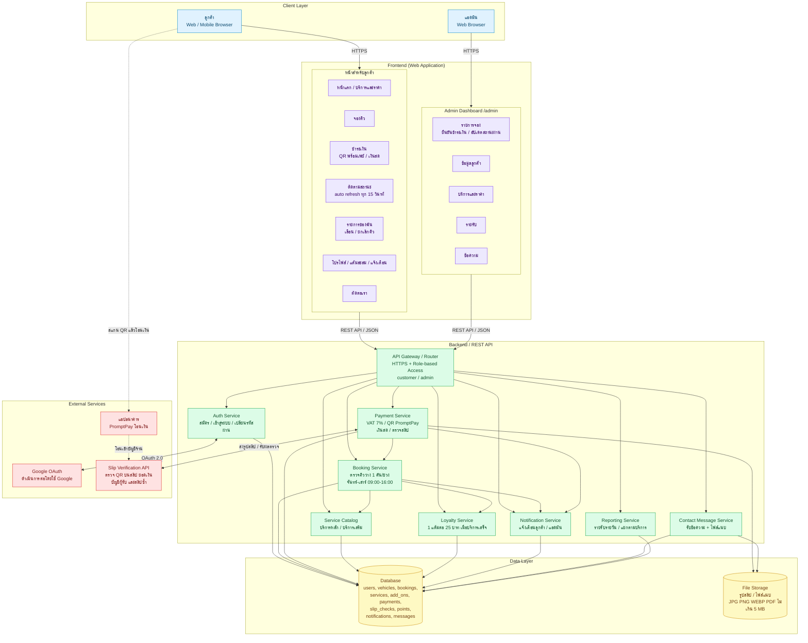
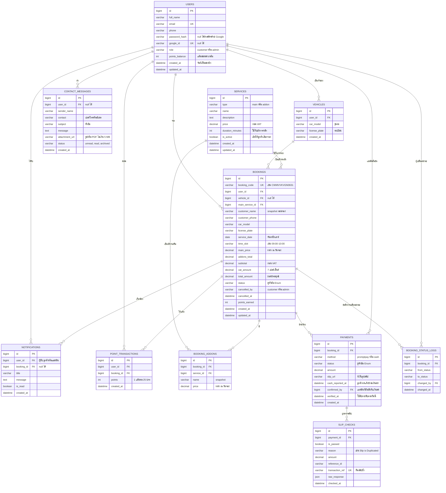

```mermaid
flowchart LR
    ROOT["📦 car-wash-project<br/>ระบบจองคิวล้างรถออนไลน์"]:::root

    %% ================= ROOT FILES =================
    ROOT --> R1[".gitignore<br/>ไฟล์ที่ไม่นำขึ้น Git"]:::file
    ROOT --> R2[".keep<br/>ไฟล์เปล่าเพื่อเก็บโฟลเดอร์"]:::file
    ROOT --> R3["docker-compose.yml<br/>รันทุก service ตอนพัฒนา"]:::file
    ROOT --> R4["docker-compose.production.yml<br/>ตั้งค่า Docker สำหรับ production"]:::file
    ROOT --> R5["README.md<br/>เอกสารอธิบายโปรเจกต์"]:::file

    %% ================= .github =================
    ROOT --> GH["📁 .github"]:::folder
    GH --> GHW["📁 workflows<br/>GitHub Actions"]:::folder
    GHW --> GHW1["deploy.yml<br/>CI/CD deploy อัตโนมัติ"]:::file

    %% ================= client =================
    ROOT --> CL["📁 client<br/>Frontend: React + Vite + Tailwind"]:::folder
    CL --> CL1[".dockerignore<br/>ไฟล์ที่ไม่ใส่ใน Docker image"]:::file
    CL --> CL2[".env.example<br/>ตัวอย่างตัวแปรสภาพแวดล้อม"]:::file
    CL --> CL3["Dockerfile<br/>build image ฝั่งหน้าเว็บ"]:::file
    CL --> CL4["index.html<br/>หน้า HTML หลักของแอป"]:::file
    CL --> CL5["nginx.conf<br/>เสิร์ฟไฟล์เว็บใน container"]:::file
    CL --> CL6["package.json<br/>รายการ dependencies และ scripts"]:::file
    CL --> CL7["package-lock.json<br/>ล็อกเวอร์ชัน dependencies"]:::file
    CL --> CL8["postcss.config.js<br/>ตั้งค่า PostCSS"]:::file
    CL --> CL9["tailwind.config.js<br/>ตั้งค่า Tailwind CSS"]:::file
    CL --> CL10["vercel.json<br/>ตั้งค่า deploy บน Vercel"]:::file
    CL --> CL11["vite.config.js<br/>ตั้งค่า Vite build tool"]:::file

    CL --> PUB["📁 public"]:::folder
    PUB --> IMG["📁 images<br/>รูปภาพที่ใช้ในเว็บ"]:::folder
    IMG --> IMG1["car-wash-1 ถึง 4.png<br/>รูปประกอบหน้าเว็บ"]:::file
    IMG --> IMG2["cash-payment.png<br/>ไอคอนชำระเงินสด"]:::file
    IMG --> IMG3["slip2go-logo.png<br/>โลโก้ระบบตรวจสลิป"]:::file

    CL --> SRC["📁 src<br/>ซอร์สโค้ดหน้าเว็บ"]:::folder
    SRC --> S1["main.jsx<br/>จุดเริ่มต้นแอป React"]:::file
    SRC --> S2["App.jsx<br/>กำหนด routes ของแต่ละหน้า"]:::file
    SRC --> S3["api.js<br/>ฟังก์ชันเรียก Backend API"]:::file
    SRC --> S4["auth.jsx<br/>จัดการสถานะล็อกอิน"]:::file
    SRC --> S5["index.css<br/>สไตล์หลักและ Tailwind"]:::file

    SRC --> COMP["📁 components<br/>คอมโพเนนต์ที่ใช้ซ้ำ"]:::folder
    COMP --> CO1["GoogleSignInButton.jsx<br/>ปุ่มเข้าสู่ระบบด้วย Google"]:::file
    COMP --> CO2["Icons.jsx<br/>รวมไอคอน SVG"]:::file
    COMP --> CO3["Layout.jsx<br/>โครงหน้า header / footer"]:::file
    COMP --> CO4["RouteGuards.jsx<br/>ป้องกันหน้าที่ต้องล็อกอิน / admin"]:::file

    SRC --> PG["📁 pages<br/>หน้าต่าง ๆ ของเว็บ"]:::folder
    PG --> PG1["HomePage.jsx<br/>หน้าแรก"]:::file
    PG --> PG2["ServicesPage.jsx<br/>รายการบริการและราคา"]:::file
    PG --> PG3["BookingPage.jsx<br/>จองคิวล้างรถ"]:::file
    PG --> PG4["PaymentPage.jsx<br/>ชำระเงิน / แนบสลิป"]:::file
    PG --> PG5["StatusPage.jsx<br/>สถานะการจอง"]:::file
    PG --> PG6["TrackingPage.jsx<br/>ติดตามคิว"]:::file
    PG --> PG7["NotificationsPage.jsx<br/>การแจ้งเตือน"]:::file
    PG --> PG8["ProfilePage.jsx<br/>โปรไฟล์และแต้มสะสม"]:::file
    PG --> PG9["ContactPage.jsx<br/>ติดต่อร้าน / แนบไฟล์"]:::file
    PG --> PG10["AuthPage.jsx<br/>สมัครสมาชิก / เข้าสู่ระบบ"]:::file
    PG --> PG11["AdminPage.jsx<br/>แผงควบคุมผู้ดูแลระบบ"]:::file

    SRC --> CUT["📁 utils<br/>ฟังก์ชันช่วยเหลือ"]:::folder
    CUT --> CUT1["date.js<br/>จัดรูปแบบวันที่และเวลา"]:::file

    %% ================= database =================
    ROOT --> DB["📁 database<br/>โครงสร้างฐานข้อมูล"]:::folder
    DB --> DB1["schema.sql<br/>สร้างตารางทั้งหมด"]:::file
    DB --> DB2["seed.sql<br/>ข้อมูลตั้งต้น"]:::file
    DB --> MIG["📁 migrations<br/>อัปเดตฐานข้อมูลตามลำดับ"]:::folder
    MIG --> M2["002_booking_slot_index.sql<br/>index ช่วงเวลาการจอง"]:::file
    MIG --> M3["003_google_auth.sql<br/>รองรับล็อกอิน Google"]:::file
    MIG --> M4["004_loyalty_points.sql<br/>ระบบแต้มสะสม"]:::file
    MIG --> M5["005_profile_notifications.sql<br/>โปรไฟล์และการแจ้งเตือน"]:::file
    MIG --> M6["006_booking_in_service_status.sql<br/>สถานะกำลังให้บริการ"]:::file
    MIG --> M7["007_payment_summary.sql<br/>สรุปข้อมูลการชำระเงิน"]:::file
    MIG --> M8["008_slip_verification_history.sql<br/>ประวัติการตรวจสลิป"]:::file
    MIG --> M9["009_payment_timestamp.sql<br/>เวลาที่ชำระเงิน"]:::file
    MIG --> M10["010_cash_payment_method.sql<br/>เพิ่มการชำระด้วยเงินสด"]:::file
    MIG --> M11["011_contact_attachment_original_name.sql<br/>เก็บชื่อไฟล์แนบต้นฉบับ"]:::file

    %% ================= deploy =================
    ROOT --> DP["📁 deploy<br/>ไฟล์สำหรับเซิร์ฟเวอร์จริง"]:::folder
    DP --> DP1["nginx-carwash.conf.example<br/>ตัวอย่าง Nginx reverse proxy"]:::file

    %% ================= server =================
    ROOT --> SV["📁 server<br/>Backend: Node.js + Express"]:::folder
    SV --> SV1[".dockerignore<br/>ไฟล์ที่ไม่ใส่ใน Docker image"]:::file
    SV --> SV2[".env.example<br/>ตัวอย่างตัวแปร เช่น DB, secret"]:::file
    SV --> SV3["Dockerfile<br/>build image ฝั่ง API"]:::file
    SV --> SV4["package.json<br/>รายการ dependencies และ scripts"]:::file
    SV --> SV5["package-lock.json<br/>ล็อกเวอร์ชัน dependencies"]:::file

    SV --> SSRC["📁 src<br/>ซอร์สโค้ด API"]:::folder
    SSRC --> SS1["server.js<br/>จุดเริ่มต้น Express server"]:::file
    SSRC --> SS2["db.js<br/>เชื่อมต่อฐานข้อมูล"]:::file

    SSRC --> MW["📁 middleware<br/>ทำงานก่อนเข้า route"]:::folder
    MW --> MW1["auth.js<br/>ตรวจ token และสิทธิ์ผู้ใช้"]:::file
    MW --> MW2["upload.js<br/>อัปโหลดไฟล์ทั่วไป"]:::file
    MW --> MW3["privateUpload.js<br/>อัปโหลดไฟล์ส่วนตัว เช่น สลิป"]:::file

    SSRC --> RT["📁 routes<br/>API endpoints"]:::folder
    RT --> RT1["auth.js<br/>สมัคร / ล็อกอิน / Google"]:::file
    RT --> RT2["services.js<br/>ข้อมูลบริการ"]:::file
    RT --> RT3["bookings.js<br/>การจองและการชำระเงิน"]:::file
    RT --> RT4["profile.js<br/>ข้อมูลโปรไฟล์ผู้ใช้"]:::file
    RT --> RT5["notifications.js<br/>การแจ้งเตือน"]:::file
    RT --> RT6["contacts.js<br/>ข้อความติดต่อ"]:::file
    RT --> RT7["admin.js<br/>API สำหรับผู้ดูแลระบบ"]:::file

    SSRC --> SUT["📁 utils<br/>ฟังก์ชันช่วยเหลือ"]:::folder
    SUT --> SUT1["filename.js<br/>ตั้งชื่อไฟล์อัปโหลดให้ปลอดภัย"]:::file

    SV --> UP["📁 uploads<br/>เก็บไฟล์ที่ผู้ใช้อัปโหลด"]:::folder
    UP --> UP1[".gitkeep<br/>เก็บโฟลเดอร์ว่างไว้ใน Git"]:::file

    %% ================= STYLES =================
    classDef root fill:#2b6cb0,stroke:#1a4971,color:#ffffff,font-weight:bold
    classDef folder fill:#fff4d6,stroke:#e0a800,color:#333333,font-weight:bold
    classDef file fill:#eef4ff,stroke:#6c8ebf,color:#333333
```

2) โครงสร้างของระบบ (System Architecture)

2.1 แผนภาพสถาปัตยกรรม แสดงส่วนประกอบและการเชื่อมต่อ (Client → Frontend → Backend/API → Database และบริการภายนอก)

2.2 โครงสร้างโฟลเดอร์ของโปรเจกต์ แสดงเป็น tree พร้อมคำอธิบาย

| ไฟล์ / โฟลเดอร์ | คำอธิบาย |
|---|---|
| `.gitignore` | ระบุไฟล์ที่ไม่นำขึ้น Git เช่น `node_modules`, `.env` |
| `.keep` | ไฟล์เปล่าสำหรับเก็บโฟลเดอร์ไว้ใน Git |
| `docker-compose.yml` | รัน client, server และฐานข้อมูลพร้อมกันตอนพัฒนา |
| `docker-compose.production.yml` | ตั้งค่า Docker สำหรับขึ้นระบบจริง (production) |
| `README.md` | เอกสารอธิบายโปรเจกต์ |
| `.github/workflows/deploy.yml` | GitHub Actions สำหรับ deploy อัตโนมัติเมื่อ push โค้ด |
| `deploy/nginx-carwash.conf.example` | ตัวอย่างค่าตั้ง Nginx reverse proxy บนเซิร์ฟเวอร์จริง |

### 💻 client — Frontend (React + Vite + Tailwind)
| ไฟล์ / โฟลเดอร์ | คำอธิบาย |
|---|---|
| `client/.dockerignore` | ไฟล์ที่ไม่ใส่ใน Docker image |
| `client/.env.example` | ตัวอย่างตัวแปรสภาพแวดล้อม เช่น URL ของ API |
| `client/Dockerfile` | build image ฝั่งหน้าเว็บ |
| `client/nginx.conf` | ตั้งค่า Nginx สำหรับเสิร์ฟหน้าเว็บใน container |
| `client/index.html` | หน้า HTML หลักของแอป |
| `client/package.json` | รายการ dependencies และ scripts |
| `client/package-lock.json` | ล็อกเวอร์ชัน dependencies |
| `client/vite.config.js` | ตั้งค่า Vite (build tool) |
| `client/tailwind.config.js` | ตั้งค่า Tailwind CSS |
| `client/postcss.config.js` | ตั้งค่า PostCSS |
| `client/vercel.json` | ตั้งค่าการ deploy บน Vercel |
| `client/public/images/car-wash-1~4.png` | รูปภาพประกอบหน้าเว็บ |
| `client/public/images/cash-payment.png` | ไอคอนชำระเงินสด |
| `client/public/images/slip2go-logo.png` | โลโก้ระบบตรวจสลิป Slip2Go |

### 📁 client/src — ซอร์สโค้ดหน้าเว็บ
| ไฟล์ / โฟลเดอร์ | คำอธิบาย |
|---|---|
| `src/main.jsx` | จุดเริ่มต้นของแอป React |
| `src/App.jsx` | กำหนดเส้นทาง (routes) ของแต่ละหน้า |
| `src/api.js` | รวมฟังก์ชันเรียก Backend API |
| `src/auth.jsx` | จัดการสถานะการล็อกอินของผู้ใช้ |
| `src/index.css` | สไตล์หลักและ Tailwind |
| `src/utils/date.js` | ฟังก์ชันจัดรูปแบบวันที่และเวลา |
| `src/components/GoogleSignInButton.jsx` | ปุ่มเข้าสู่ระบบด้วย Google |
| `src/components/Icons.jsx` | รวมไอคอน SVG ที่ใช้ในเว็บ |
| `src/components/Layout.jsx` | โครงหน้าเว็บ (header / footer / เมนู) |
| `src/components/RouteGuards.jsx` | ป้องกันหน้าที่ต้องล็อกอินหรือเฉพาะ admin |

### 📄 client/src/pages — หน้าต่าง ๆ ของเว็บ
| ไฟล์ | คำอธิบาย |
|---|---|
| `HomePage.jsx` | หน้าแรกของเว็บไซต์ |
| `ServicesPage.jsx` | แสดงรายการบริการและราคา |
| `BookingPage.jsx` | เลือกบริการ วัน และเวลาเพื่อจองคิว |
| `PaymentPage.jsx` | ชำระเงิน แนบสลิป หรือเลือกเงินสด |
| `StatusPage.jsx` | แสดงสถานะการจอง |
| `TrackingPage.jsx` | ติดตามคิวล้างรถ |
| `NotificationsPage.jsx` | รายการแจ้งเตือนของผู้ใช้ |
| `ProfilePage.jsx` | ข้อมูลโปรไฟล์และแต้มสะสม |
| `ContactPage.jsx` | ส่งข้อความติดต่อร้านพร้อมแนบไฟล์ |
| `AuthPage.jsx` | สมัครสมาชิก / เข้าสู่ระบบ |
| `AdminPage.jsx` | แผงควบคุมสำหรับผู้ดูแลระบบ |

### 🗄️ database — ฐานข้อมูล
| ไฟล์ | คำอธิบาย |
|---|---|
| `schema.sql` | สร้างตารางทั้งหมดของระบบ |
| `seed.sql` | ใส่ข้อมูลตั้งต้น เช่น รายการบริการ |
| `migrations/002_booking_slot_index.sql` | เพิ่ม index ช่วงเวลาการจอง |
| `migrations/003_google_auth.sql` | รองรับการล็อกอินด้วย Google |
| `migrations/004_loyalty_points.sql` | เพิ่มระบบแต้มสะสม |
| `migrations/005_profile_notifications.sql` | เพิ่มข้อมูลโปรไฟล์และการแจ้งเตือน |
| `migrations/006_booking_in_service_status.sql` | เพิ่มสถานะ "กำลังให้บริการ" |
| `migrations/007_payment_summary.sql` | เพิ่มข้อมูลสรุปการชำระเงิน |
| `migrations/008_slip_verification_history.sql` | เก็บประวัติการตรวจสลิป |
| `migrations/009_payment_timestamp.sql` | เก็บเวลาที่ชำระเงิน |
| `migrations/010_cash_payment_method.sql` | เพิ่มวิธีชำระด้วยเงินสด |
| `migrations/011_contact_attachment_original_name.sql` | เก็บชื่อไฟล์แนบต้นฉบับของข้อความติดต่อ |

### 🖥️ server — Backend (Node.js + Express)
| ไฟล์ / โฟลเดอร์ | คำอธิบาย |
|---|---|
| `server/.dockerignore` | ไฟล์ที่ไม่ใส่ใน Docker image |
| `server/.env.example` | ตัวอย่างตัวแปร เช่น ค่าเชื่อมต่อฐานข้อมูล, secret key |
| `server/Dockerfile` | build image ฝั่ง API |
| `server/package.json` | รายการ dependencies และ scripts |
| `server/package-lock.json` | ล็อกเวอร์ชัน dependencies |
| `server/uploads/` | โฟลเดอร์เก็บไฟล์ที่ผู้ใช้อัปโหลด (`.gitkeep` ใช้เก็บโฟลเดอร์ว่างไว้ใน Git) |
| `src/server.js` | จุดเริ่มต้นของ Express API server |
| `src/db.js` | เชื่อมต่อฐานข้อมูล |
| `src/middleware/auth.js` | ตรวจ token และสิทธิ์ผู้ใช้ก่อนเข้าถึง API |
| `src/middleware/upload.js` | จัดการอัปโหลดไฟล์ทั่วไป |
| `src/middleware/privateUpload.js` | จัดการไฟล์ส่วนตัว เช่น สลิปโอนเงิน |
| `src/utils/filename.js` | ตั้งชื่อไฟล์อัปโหลดให้ปลอดภัยและไม่ซ้ำกัน |

### 🔌 server/src/routes — API Endpoints
| ไฟล์ | คำอธิบาย |
|---|---|
| `auth.js` | สมัครสมาชิก / เข้าสู่ระบบ / ล็อกอินด้วย Google |
| `services.js` | ข้อมูลบริการล้างรถ |
| `bookings.js` | สร้างการจอง ดูสถานะ และชำระเงิน |
| `profile.js` | ดูและแก้ไขข้อมูลโปรไฟล์ |
| `notifications.js` | การแจ้งเตือนของผู้ใช้ |
| `contacts.js` | รับข้อความติดต่อจากลูกค้า |
| `admin.js` | API สำหรับผู้ดูแลระบบ |
2.3 โครงสร้างฐานข้อมูล: ER Diagram และคำอธิบายแต่ละ table

## 2. คำอธิบายแต่ละ Table

### 2.1 `users` – ผู้ใช้งาน
เก็บบัญชีทั้งลูกค้าและแอดมินไว้ table เดียว แยกด้วย `role`

| Column | คำอธิบาย |
|---|---|
| `id` | รหัสผู้ใช้ (PK) |
| `full_name`, `email`, `phone` | ข้อมูลส่วนตัว แสดงในหน้าโปรไฟล์และหน้าข้อมูลลูกค้าของแอดมิน |
| `password_hash` | รหัสผ่านที่เข้ารหัสแล้ว (ว่างได้ถ้าเข้าสู่ระบบด้วย Google อย่างเดียว) |
| `google_id` | รหัสบัญชี Google สำหรับ "ดำเนินการต่อโดยใช้ Google" |
| `role` | `customer` หรือ `admin` ใช้กำหนดสิทธิ์เข้า `/admin` |
| `points_balance` | แต้มสะสมคงเหลือ (เก็บซ้ำเพื่อเรียกดูเร็ว ค่าจริงตรวจสอบย้อนหลังได้จาก `point_transactions`) |
| `created_at` | วันที่เป็นสมาชิก |

### 2.2 `vehicles` – ประวัติรถ
รถที่ลูกค้าเคยจองหรือบันทึกไว้ (ปุ่ม + เพิ่มรถ ในหน้าโปรไฟล์) ลูกค้า 1 คนมีได้หลายคัน

| Column | คำอธิบาย |
|---|---|
| `user_id` | เจ้าของรถ (FK → users) |
| `car_model` | รุ่นรถ เช่น adv150, wave125 |
| `license_plate` | ทะเบียนรถ ใช้ค้นหาในหน้าแอดมิน |

### 2.3 `services` – บริการและราคา
เก็บทั้งบริการหลัก (Standard / Premium / Full Detailing) และบริการเสริม (เคลือบแก้ว, ขัดโคมไฟ ฯลฯ) แยกด้วย `type`

| Column | คำอธิบาย |
|---|---|
| `type` | `main` = บริการหลัก, `addon` = บริการเสริม |
| `price` | ราคาก่อน VAT 7% |
| `duration_minutes` | ระยะเวลาให้บริการ (ใช้กับบริการหลัก) |
| `is_active` | เปิดให้ลูกค้าเลือกจองหรือไม่ ปุ่ม "ปิดบริการ" จะตั้งเป็น false แทนการลบ เพื่อให้ประวัติเดิมยังอ้างอิงได้ |

### 2.4 `bookings` – การจอง (ตารางหลัก)
1 แถวต่อ 1 การจอง

| Column | คำอธิบาย |
|---|---|
| `booking_code` | รหัสจองที่แสดงให้ลูกค้า ใช้ค้นหา/ติดตามสถานะ |
| `user_id`, `vehicle_id`, `main_service_id` | อ้างอิงลูกค้า รถ และบริการหลัก |
| `customer_name`, `customer_phone`, `car_model`, `license_plate` | สำเนาข้อมูลตอนจอง (snapshot) เพื่อไม่เปลี่ยนตามโปรไฟล์ภายหลัง |
| `service_date`, `time_slot` | วันและช่วงเวลา (จันทร์–เสาร์ 09:00–16:00 เว้นพักเที่ยง) |
| `main_price`, `addons_total`, `subtotal`, `vat_amount`, `total_amount` | เก็บราคา ณ วันจอง การปรับราคาในภายหลังจึงไม่กระทบการจองเดิม |
| `status` | สถานะการจอง (ดู Enum) |
| `cancelled_by`, `cancelled_at` | ผู้ยกเลิกและเวลา |
| `points_earned` | แต้มที่ได้ เมื่อสถานะเป็นพร้อมรับรถแล้ว |

**กฎสำคัญ:** 1 ช่วงเวลารับได้ 1 คัน ให้ตั้ง unique index บน `(service_date, time_slot)` เฉพาะแถวที่ `status <> 'cancelled'` (partial/unique index) เพื่อกันจองซ้อนกัน

### 2.5 `booking_addons` – บริการเสริมในแต่ละการจอง
ตารางเชื่อม many-to-many ระหว่าง `bookings` กับ `services` (type = addon) เก็บ `name` และ `price` ณ วันจองไว้ด้วย

### 2.6 `payments` – การชำระเงิน
แยกจาก `bookings` เพื่อรองรับกรณีสลิปไม่ผ่านแล้วลูกค้าส่งใหม่ หรือเปลี่ยนช่องทางชำระ

| Column | คำอธิบาย |
|---|---|
| `method` | `promptpay` (QR + สลิป) หรือ `cash` (จ่ายที่ร้าน) |
| `status` | สถานะการชำระเงิน (ดู Enum) |
| `slip_url` | ตำแหน่งไฟล์สลิป (JPG, PNG, WEBP) |
| `cash_reported_at` | เวลาที่ลูกค้ากด "แจ้งชำระเงินสด" |
| `confirmed_by` | แอดมินที่กดยืนยันรับเงินสด |
| `verified_at` | เวลายืนยันการชำระเงินจริง **หน้ารายรับใช้ฟิลด์นี้นับยอดรายวัน** ไม่ใช่วันที่นัดล้างรถ |

### 2.7 `slip_checks` – ประวัติผลตรวจสลิป
เก็บผลตรวจจากบริการตรวจสลิป ทุกครั้ง (ปุ่ม "ประวัติผลตรวจ" ของแอดมิน)

| Column | คำอธิบาย |
|---|---|
| `is_passed` | ผ่านหรือไม่ผ่าน |
| `reason` | เหตุผล เช่น Slip is Duplicated, ยอดไม่ตรง |
| `reference_id`, `transaction_ref` | รหัสอ้างอิงจากผู้ให้บริการและธนาคาร ใช้ตรวจสลิปซ้ำ (`transaction_ref` ควรเป็น unique เมื่อผ่านแล้ว) |
| `raw_response` | ผลตอบกลับดิบจาก API เก็บไว้ตรวจสอบย้อนหลัง |

### 2.8 `point_transactions` – ประวัติแต้มสะสม
บันทึกแต้มทุกครั้งที่ได้ (1 แต้มต่อทุก 25 บาท เมื่อบริการเสร็จสิ้น) ใช้แสดงในหน้า Customer Record ของแอดมิน และใช้ตรวจสอบ `users.points_balance`

### 2.9 `notifications` – การแจ้งเตือน
ไอคอนกระดิ่งของทั้งลูกค้าและแอดมิน

| Column | คำอธิบาย |
|---|---|
| `user_id` | ผู้รับแจ้งเตือน |
| `booking_id` | การจองที่เกี่ยวข้อง (ว่างได้) |
| `is_read` | ใช้แสดงตัวเลขสีแดงของที่ยังไม่อ่าน |

ตัวอย่างเหตุการณ์: ได้รับคำขอจอง, รับรถเข้าคิวแล้ว, กำลังให้บริการ, พร้อมรับรถแล้ว (ลูกค้า) / ยืนยันชำระเงินแล้ว, สลิปไม่ผ่าน (แอดมิน)

### 2.10 `contact_messages` – ข้อความจากหน้า "ติดต่อเรา"
| Column | คำอธิบาย |
|---|---|
| `subject` | สอบถามบริการ / สอบถามการจอง / แจ้งปัญหา / ข้อเสนอแนะ |
| `attachment_url` | ไฟล์แนบ (รูปภาพหรือ PDF ไม่เกิน 5 MB) |
| `status` | `unread` / `read` / `archived` (ยังไม่อ่าน / อ่านแล้ว / เก็บถาวร) |

### 2.11 `booking_status_logs` – ประวัติการเปลี่ยนสถานะ (เสริม)
บันทึกว่าใครเปลี่ยนสถานะการจองจากอะไรเป็นอะไร เมื่อไหร่ เพราะการกด "พร้อมรับรถ" ย้อนกลับไม่ได้ จึงควรมี log ไว้ตรวจสอบ (ถ้าไม่ต้องการ ตัด table นี้ได้)

## 3. ค่า Enum

**`bookings.status`**

| ค่า | ความหมาย |
|---|---|
| `pending` | รอยืนยันการจอง |
| `queued` | รับรถเข้าคิวแล้ว |
| `in_service` | กำลังให้บริการ |
| `ready` | พร้อมรับรถแล้ว (จบงาน ให้แต้มสะสม) |
| `cancelled` | ยกเลิกการจอง |

**`payments.status`**

| ค่า | ความหมาย |
|---|---|
| `unpaid` | ยังไม่ชำระ |
| `pending` | รอตรวจสอบ (แนบสลิปแล้ว หรือแจ้งชำระเงินสดแล้ว) |
| `verified` | ตรวจสอบแล้ว |
| `failed` | ไม่ผ่านการตรวจสอบ |

**`payments.method`:** `promptpay`, `cash`  
**`users.role`:** `customer`, `admin`

## 4. ข้อสังเกตในการออกแบบ

- **เก็บ snapshot ราคา/ข้อมูลลูกค้าใน `bookings` และ `booking_addons`** เพราะคู่มือระบุว่าราคาใหม่มีผลกับการจองใหม่เท่านั้น
- **ไม่ลบ `services` จริง** ใช้ `is_active = false` เพื่อรักษาความสัมพันธ์กับประวัติ
- **รายรับ** คำนวณจาก `payments` ที่ `status = 'verified'` จัดกลุ่มตาม `verified_at` และแยกตามบริการด้วย join `bookings → services` (ยอดก่อน VAT = `subtotal`, VAT = `vat_amount`)
- **ป้องกันจองซ้ำ** ใช้ unique index บน `(service_date, time_slot)` ที่ไม่ใช่สถานะ `cancelled` และตรวจซ้ำใน transaction ตอนสร้าง/เลื่อนคิว
- **ป้องกันสลิปซ้ำ** ตรวจ `transaction_ref` ใน `slip_checks` ที่ `is_passed = true`
- **Index ที่ควรมี:** `bookings(user_id)`, `bookings(status)`, `bookings(booking_code)`, `bookings(license_plate)`, `payments(booking_id)`, `notifications(user_id, is_read)`

